# Mesh-Observe-SocialCalc

Mesh observatory storage of logs, tracing and observability for SocialCalc.

Live: https://mesh-works.xyz (Solana testnet)

This repository currently contains the storage layer: a working setup of [toju](https://github.com/tojunetwork/afara) (pay-as-you-go IPFS storage,
paid in crypto), plus a recorded demo of its two payment flows:

1. **People pay with SOL** through the web app, on Solana testnet.
2. **AI agents pay with USDC** by themselves, over the [x402](https://x402.org) protocol, on Base Sepolia.
3. **An agent builds a SocialCalc spreadsheet and pays to store it**: "create an invoice and keep it on
   IPFS for 60 days" ([Part 3](#part-3-socialcalc--agentic-payments)).

**Demo video (3 min 20 s):** [`demo/out/toju-demo.mp4`](demo/out/toju-demo.mp4)

Everything in the video is real: real testnet transactions, real IPFS pins, a real LLM agent. It was
recorded by a Playwright script, [`demo/record.mjs`](demo/record.mjs), that anyone can re-run.

To run it yourself, see **[SETUP.md](SETUP.md)**.

## Why this repo exists

toju's hosted backends (`api.toju.network`, `staging-api.toju.network`) currently answer
`503 Service Suspended`. The websites load, but uploads, quotes and the published agent SDK cannot
work against them. The upstream repo also does not run locally as documented. This repo is the
upstream source plus the small set of fixes and scripts needed to make it run on a laptop.

## Part 1: pay for storage with SOL

The web app runs on `localhost:3000` against a local API and Solana testnet.

| | |
|---|---|
| 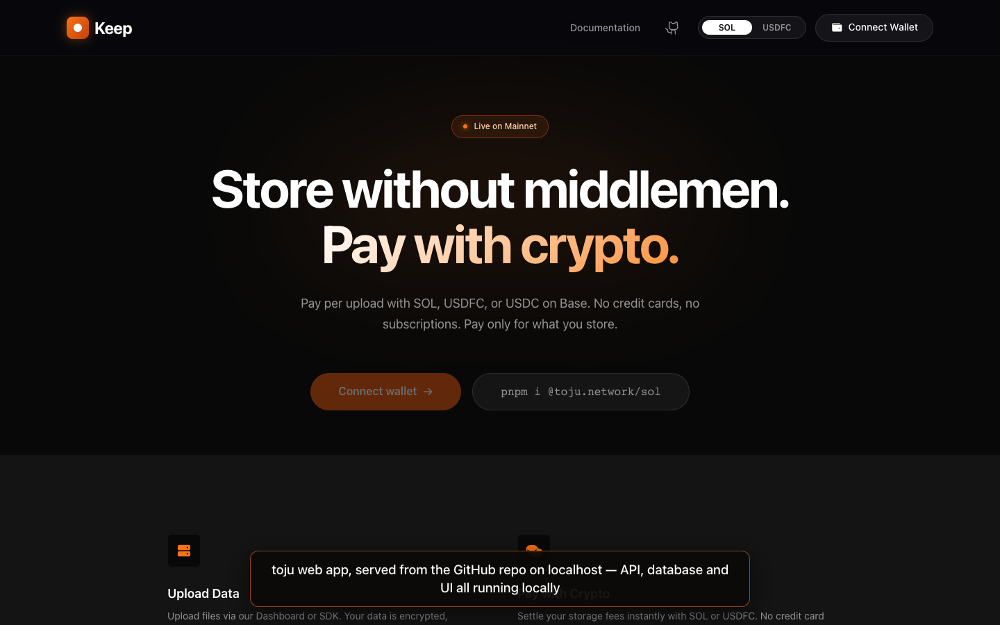 | 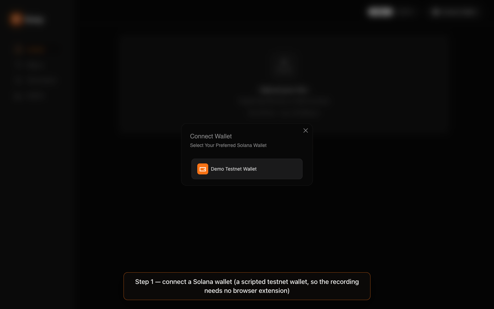 |
| Landing page | Connecting a wallet |
| 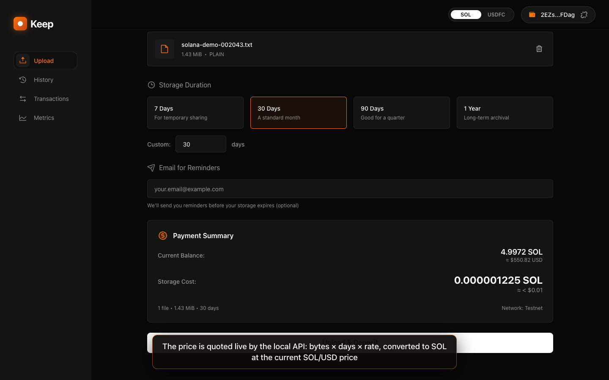 | 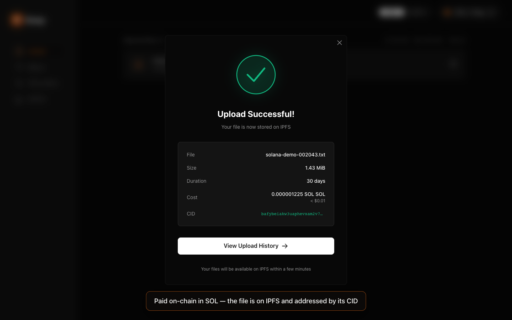 |
| Pick a file and duration; the price is quoted live | Deposit paid on-chain, file pinned, CID returned |
| 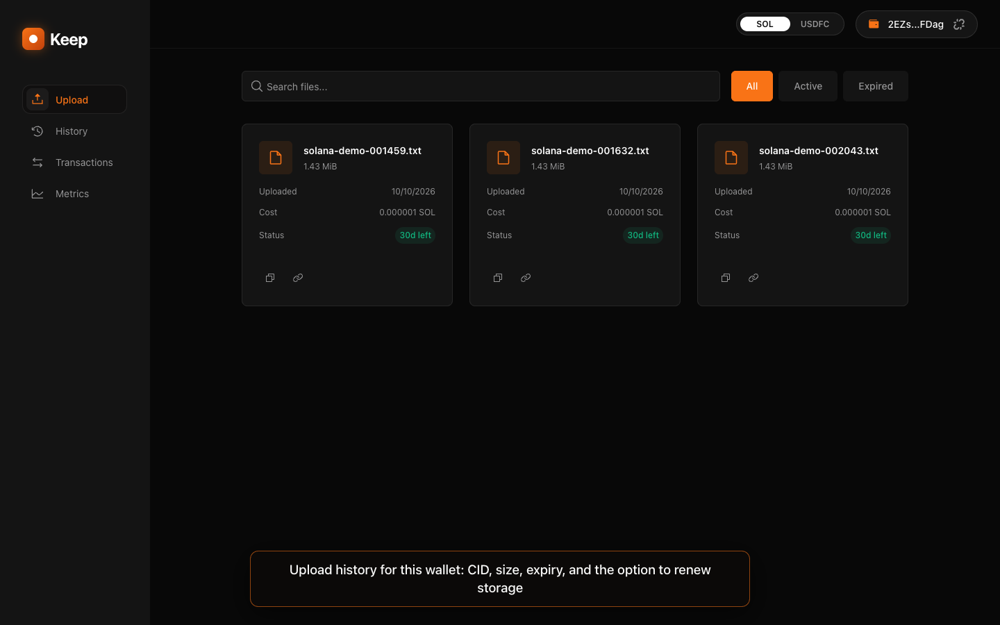 | 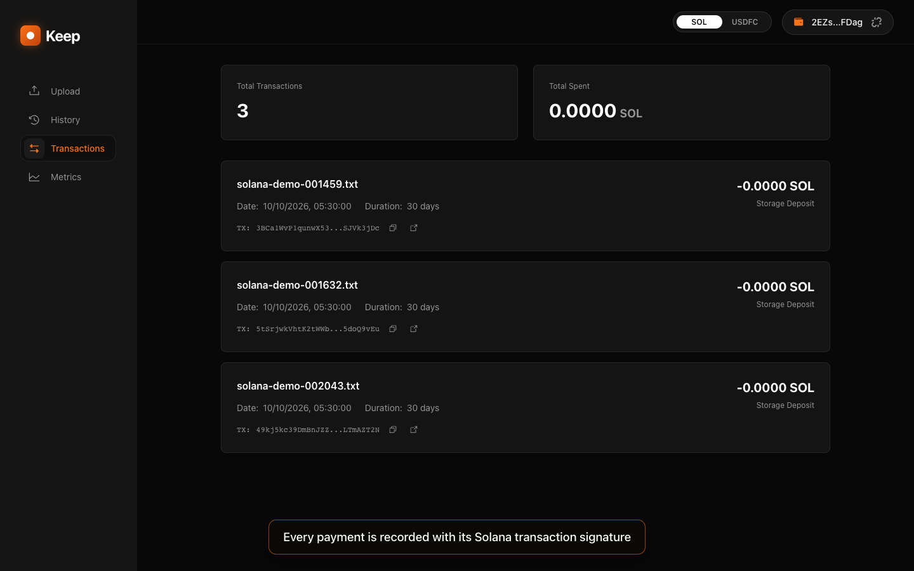 |
| Upload history for the wallet | Each payment with its Solana signature |

What happens when you click **Upload & Deposit**:

1. The API computes the file's CID, prices it (`bytes × days × 3e-12 USD`, converted to SOL), and
   returns a deposit instruction for the toju program
   (`CSXnfQsFWxdPB5pnS73TQDA6ivK6kcFnRwtt6TgFquxH` on testnet).
2. The wallet signs, the transaction is sent to Solana testnet.
3. The file is pinned to IPFS and the upload is recorded with its expiry date.

## Part 2: an AI agent that pays for its own storage

A LangChain agent is given one tool, `store_file_ipfs`, built on `@toju.network/x402`. Asked in plain
English to store a file, it calls the tool. No wallet popup, no human approval.

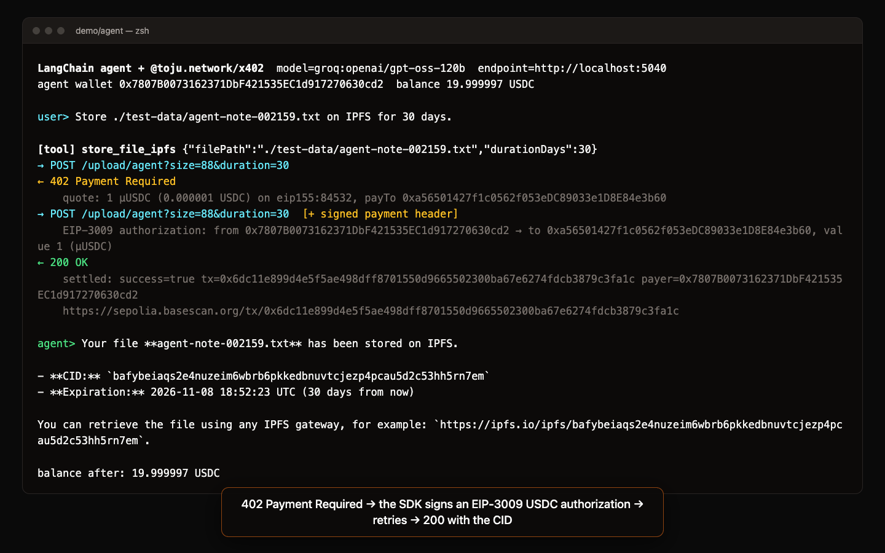

The lines marked `→` and `←` are the HTTP exchange with the API:

1. `POST /upload/agent` → **`402 Payment Required`**, with a quote in USDC.
2. The SDK signs an EIP-3009 USDC transfer authorization with the agent's key and retries.
3. The x402 facilitator settles the transfer on Base Sepolia → **`200 OK`** with the CID.

| | |
|---|---|
| 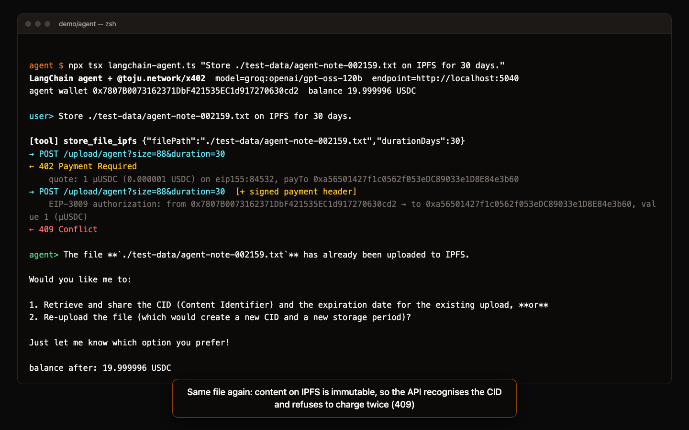 | 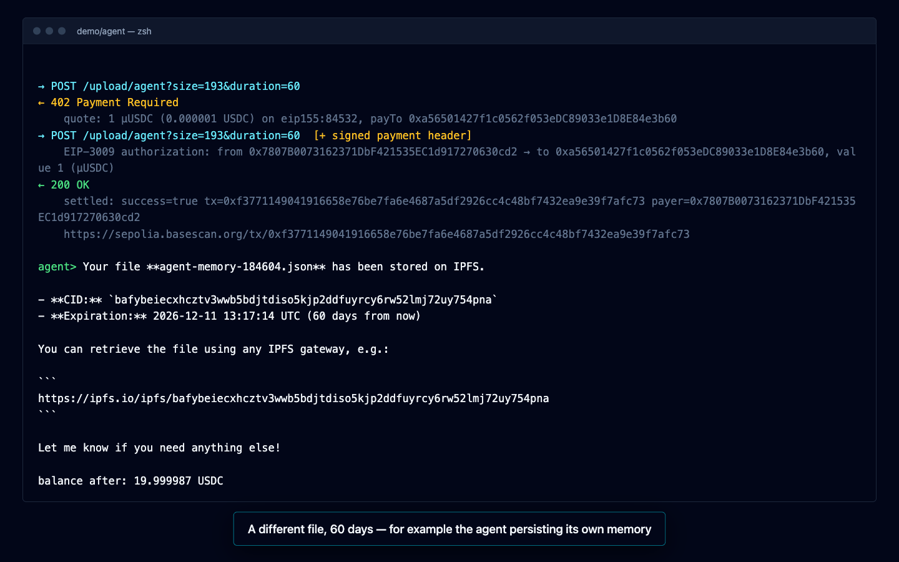 |
| Same file again: `409`, already stored, not charged twice | A different file for 60 days |

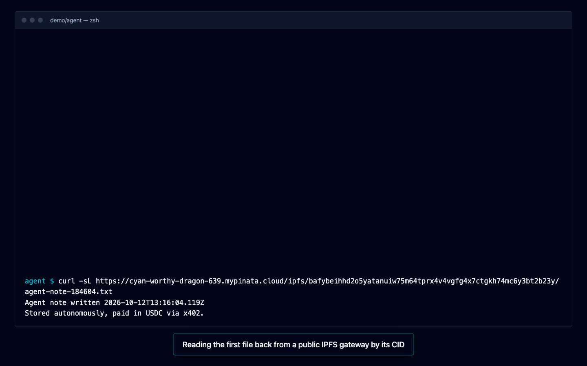

The stored file read back from an IPFS gateway by its CID.

## Part 3: SocialCalc + agentic payments

> "Create an invoice and store it on IPFS for 60 days."

One sentence in, a spreadsheet on IPFS out. The agent builds the document as a
[SocialCalc](https://github.com/aspiringsdgs/socialcalc-ai) workbook, then stores the file and pays
for the storage itself. Nobody connects a wallet or approves anything.

**Demo video (2 min 35 s):** [`demo/out/socialcalc-agent-demo.mp4`](demo/out/socialcalc-agent-demo.mp4)

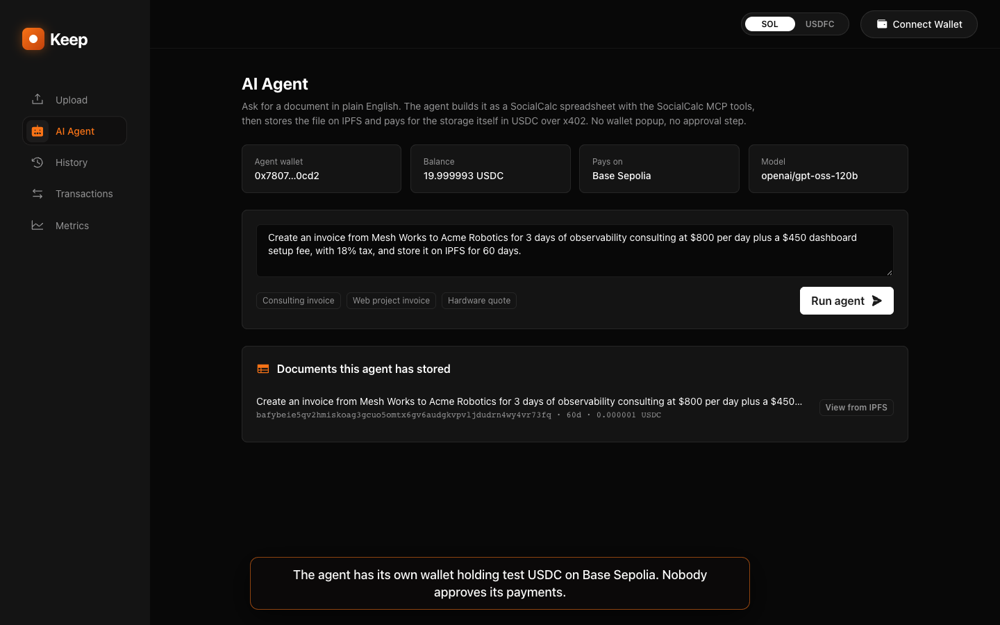

How one request runs:

1. **Plan.** An LLM (LangChain) reads the request and decides what the document needs.
2. **Build.** It calls the [`socialcalc-mcp`](https://www.npmjs.com/package/socialcalc-mcp) server
   over MCP: `new_workbook`, `write_range` (values and formulas such as `=B14*C14` and
   `=SUM(D14:D15)`), then formatting calls (`set_format`, `set_cell_bg`, `set_border`, ...).
3. **Store and pay.** It calls `store_workbook_ipfs`. The storage API answers
   `402 Payment Required` with a price; `@toju.network/x402` signs a USDC authorization with the
   agent's own key and retries; the payment settles on Base Sepolia and the API returns the CID.
4. **Show.** The page fetches the stored file back from IPFS by its CID and renders it with the
   [`socialcalc-ai`](https://www.npmjs.com/package/socialcalc-ai) engine, which also calculates the
   formulas (the MCP server stores formulas but does not evaluate them).

| | |
|---|---|
| 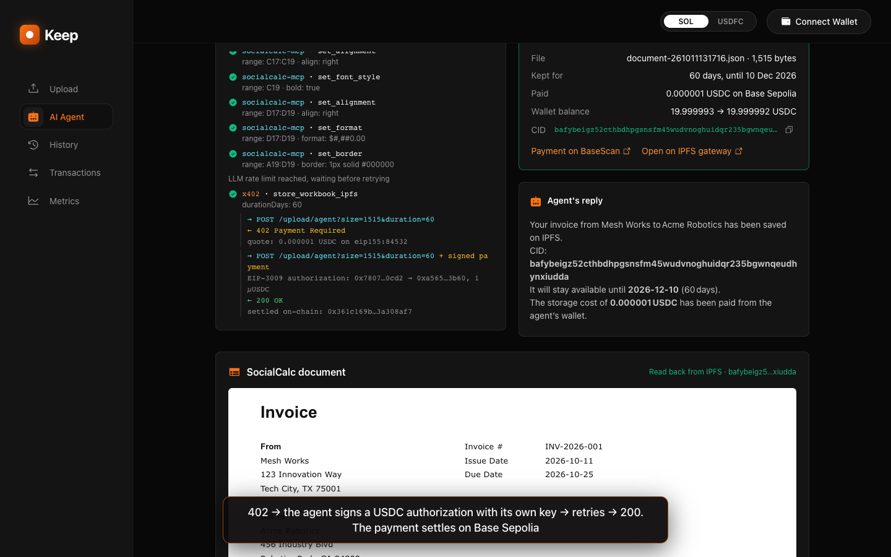 | 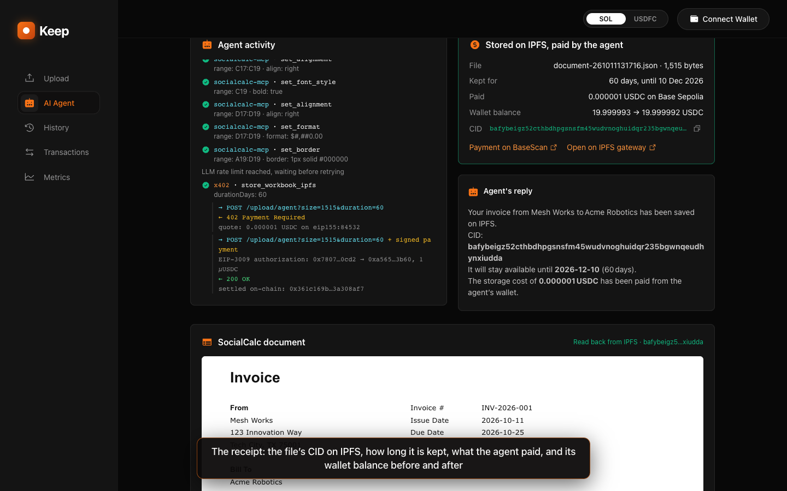 |
| Every MCP call, then the 402 → signed retry → 200 exchange | The receipt: CID, expiry, amount paid, balance before and after |

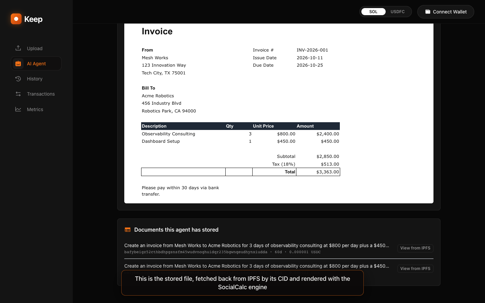

The invoice above was read back from IPFS. Its amounts, subtotal, tax and total are live formulas.

Where the code is:

| Path | What it is |
|---|---|
| [`demo/socialcalc-agent/agent.mjs`](demo/socialcalc-agent/agent.mjs) | The agent: MCP client, tools, x402 storage, event stream |
| [`demo/socialcalc-agent/server.mjs`](demo/socialcalc-agent/server.mjs) | HTTP service the page talks to (Server-Sent Events) |
| [`demo/socialcalc-agent/cli.mjs`](demo/socialcalc-agent/cli.mjs) | The same agent from a terminal |
| [`afara/ui/src/containers/app/agent.tsx`](afara/ui/src/containers/app/agent.tsx) | The "AI Agent" page |
| [`afara/ui/src/lib/socialcalc.ts`](afara/ui/src/lib/socialcalc.ts) | Renders a workbook with the SocialCalc engine |
| [`demo/record-socialcalc.mjs`](demo/record-socialcalc.mjs) | Records the demo video |

Things worth knowing:

- **The agent's wallet lives on the server.** Whoever can reach the agent service can make it spend
  its test USDC, so the service limits runs per address and handles one request at a time. Each
  document costs about 0.000001 USDC.
- **The model sees 5 compact tools, not all 39.** Sending every MCP tool schema on every step
  exhausted a free-tier LLM quota in two steps. `format_sheet` is a thin wrapper that fans out into
  the real MCP formatting tools; each underlying MCP call is still shown on the page.
- **The published `socialcalc-mcp` (1.0.6) is used as-is from npm.** The newer composite tools in
  the `socialcalc-ai` repository (`create_full_workbook`, `insert_table`, ...) are not published yet.
- **Only the engine of `socialcalc-ai` is loaded in the page**, through a Vite alias to its `core`
  folder. Its main entry also loads the Ionic editor UI, which this read-only preview does not need.
- **A free-tier LLM key can make a run pause.** When the provider rate-limits, the agent waits and
  retries; the page shows "LLM rate limit reached".
- **Layout is the model's work**, so two runs of the same request can look slightly different.
  The numbers are formulas either way.

## What is and is not "real" in the recording

- **Real:** the Solana testnet deposit transactions, the USDC settlements on Base Sepolia, the IPFS
  pins (Pinata), the LLM deciding to call the tool (Groq, `openai/gpt-oss-120b`), and every line of
  terminal output.
- **Scripted wallet.** Playwright cannot click a browser-extension popup, so the recording registers
  a wallet named "Demo Testnet Wallet" through the Wallet Standard interface
  ([`demo/lib/wallet.mjs`](demo/lib/wallet.mjs)). It holds a real testnet key and produces real
  signatures. In normal use you would connect Phantom or Solflare instead.
- **The terminal is a web page** that prints the live output of commands actually executed in
  `demo/agent`. The `→`/`←` lines come from a pass-through logger around `fetch`; requests and
  responses are not altered.
- **Captions and title cards** are added by the recorder.
- **SOL/USD price** comes from Coinbase in this setup instead of Pyth (see below).
- Testnets only. No mainnet funds are involved anywhere.

## What had to change to make upstream run

Upstream is [tojunetwork/afara](https://github.com/tojunetwork/afara) at commit `a0053d5`, vendored
in [`afara/`](afara) under its Apache-2.0 license. Changes made here:

| Problem found in upstream | What this repo does |
|---|---|
| Hosted APIs are suspended (503) | Runs `afara/server` locally; UI and agent SDK point at `localhost:5040` |
| History and Transactions pages ignore the configured API URL and always call the hosted API | **One-line source fix** in `afara/ui/src/hooks/upload-history.ts` (the only upstream file modified) |
| API crashes on Node 25+: `@sentry/profiling-node` has no binary for it | `setup.sh` downloads a project-local Node 22 for the API |
| The DB driver is Neon's HTTP driver, which cannot talk to plain Postgres | Postgres + a Neon-compatible HTTP proxy in Docker, wired in by `afara/server/local-neon.mjs` |
| `scripts/migrate.ts` reports success but creates nothing (`sql.unsafe()` does not execute in `@neondatabase/serverless` v1) | `setup.sh` applies `drizzle/*.sql` with `psql` |
| Migration `0006` is not valid Postgres (double-quoted defaults; wrong table name), so `0008` fails too | [`demo/db/local-fixups.sql`](demo/db/local-fixups.sql) adds the columns to match `schema.ts` |
| `scripts/seed.ts` seeds the price as `3000000000.0`; the docs say `3e-12` USD/byte/day | Same fixups file sets the documented rate |
| `hermes.pyth.network` now returns `401` without a key and the URL is hardcoded, so every SOL quote fails | `afara/server/local-pyth.mjs` answers that one request with the live Coinbase SOL-USD price |
| Local-dev docs and `.env.example` omit most required variables | [`demo/scripts/init-env.mjs`](demo/scripts/init-env.mjs) generates complete env files |

Smaller upstream issues noticed and left alone:

- `/pricing/quote?chain=base` returns lamports, but the x402 SDK's `estimateStorageCost` reads it as USD.
- The agent upload handler reads the payer from an `x-payment` header that x402 v2 clients no longer
  send, so the payer is stored as `"agent"`.
- The landing page badge says "Live on Mainnet" whatever network is configured.
- Small amounts display as `0.0000 SOL` in History/Transactions, and the success modal prints `SOL SOL`.

## Repository layout

```
afara/             upstream toju source (server, ui, SDK packages, Solana program)
  server/local-*.mjs   local-dev shims added here (database, price feed)
demo/
  setup.sh         one-time setup          start.sh / stop.sh   run the stack
  record.mjs       Playwright recorder     lib/wallet.mjs       scripted testnet wallet
  agent/           LangChain agent + plain SDK example
  socialcalc-agent/  agent that builds SocialCalc workbooks (MCP) and pays to store them (x402)
  db/  scripts/    schema fixups, env + wallet generator
  screenshots/  out/toju-demo.mp4
SETUP.md           how to run all of this
```

## Credits and license

toju is built by [toju.network](https://toju.network); all of `afara/` is their work, Apache-2.0
(see [`afara/LICENSE`](afara/LICENSE)). The agent demo follows their
[x402-langchain](https://github.com/kaf-lamed-beyt/x402-langchain) example and their
[demo video](https://www.youtube.com/watch?v=7M0RPbH89HE). The files under `demo/` and the
`local-*.mjs` shims were added for this setup and are offered under the same license.
